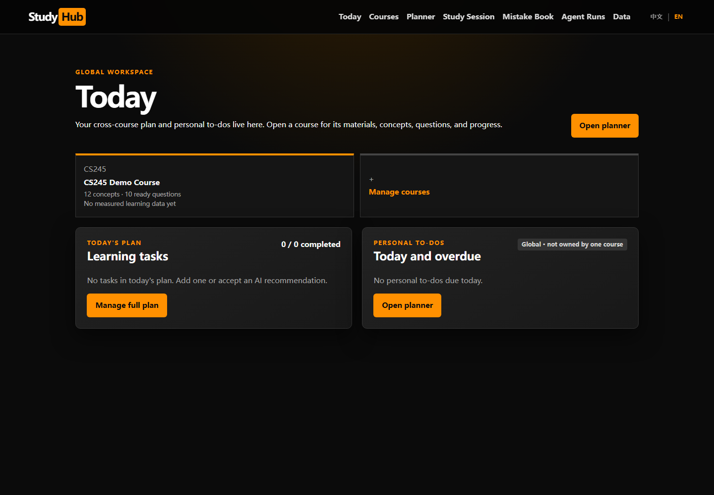
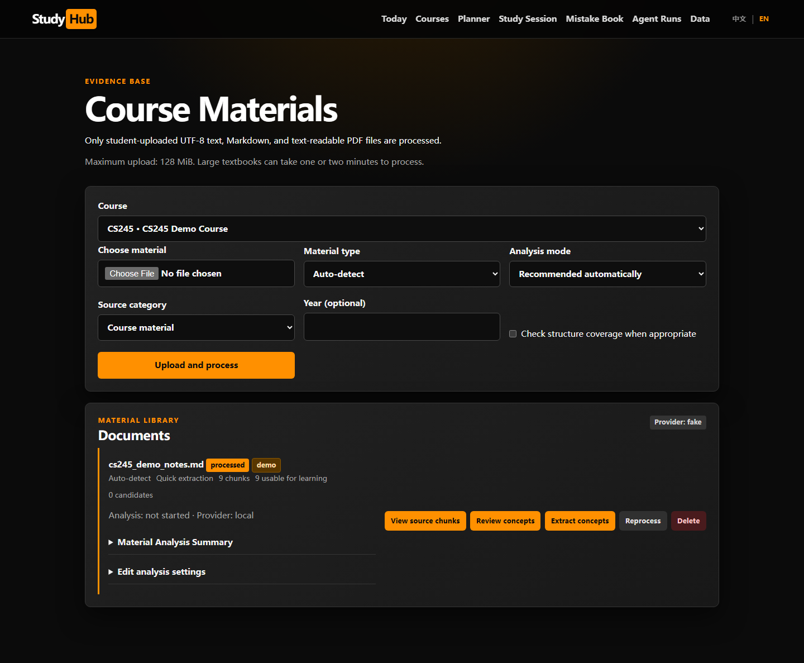
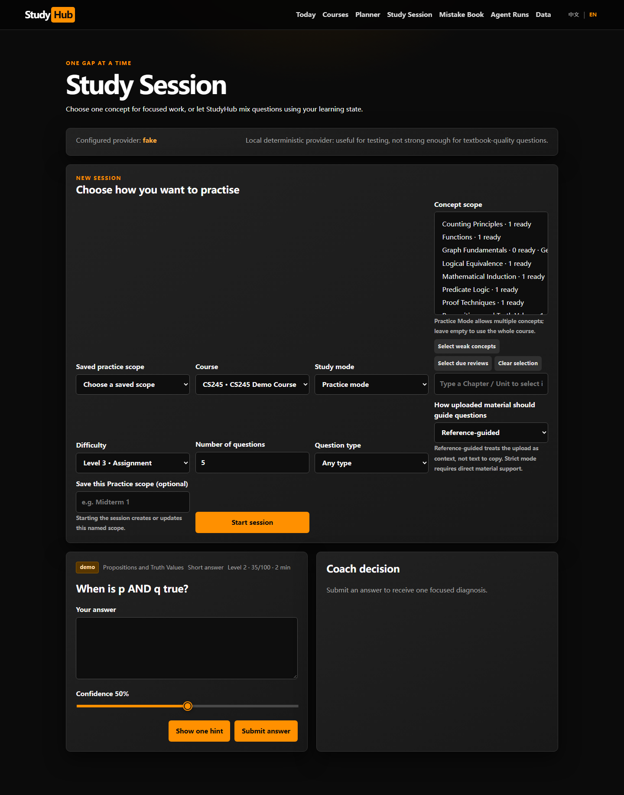
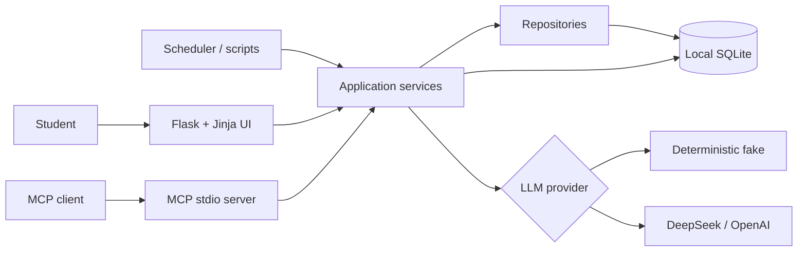

# StudyHub

**A local-first, evidence-grounded adaptive study workspace.**

[中文说明](README.zh-CN.md) · [Architecture](docs/architecture.md) · [Security](SECURITY.md) · [Contributing](CONTRIBUTING.md)

StudyHub turns course material into an auditable learning loop:

`material → concepts → reviewed questions → attempt → diagnosis → mastery → next review`

It is built for one student who wants course-aware practice without turning private notes into a generic cloud chatbot. Each course keeps its own material, concepts, questions, mistakes, plans, and progress. The application works without an API key and asks for explicit per-course consent before using an external AI provider.



> Status: portfolio-ready alpha. The core workflow is implemented and tested, while authentication, OCR, and production hosting are intentionally outside the current single-user scope.

## Why this project is interesting

- **Closed learning loop:** attempts update mastery, error history, streaks, and review needs instead of ending at a chat response.
- **Evidence-grounded AI:** concepts and explanations retain links to imported source chunks; missing evidence is reported rather than invented.
- **Human approval gates:** generated questions enter a review lifecycle before normal practice.
- **Local-first privacy:** SQLite, uploads, backups, and the generated Flask secret remain on the machine and are excluded from Git.
- **Provider abstraction:** a deterministic fake provider supports offline demos and repeatable tests; DeepSeek and OpenAI are optional.
- **Defensive engineering:** CSRF protection, idempotent attempts, validated provider output, safe fallbacks, backup verification, and per-course external-AI consent.
- **Quality gates:** Ruff, i18n validation, Alembic upgrades, coverage enforcement, dependency auditing, and a real Chromium smoke test run in CI.

## Product tour

| Materials and concept review | Adaptive study session |
|---|---|
|  |  |

The interface supports English and Simplified Chinese independently from the material and explanation language. See the [Chinese dashboard](docs/screenshots/dashboard-zh.png).

## Architecture at a glance



Flask routes, MCP tools, scheduled jobs, and maintenance scripts reuse the same service and repository layers. See the [bilingual architecture documentation](docs/architecture.md) for the learning loop, security boundaries, and design trade-offs.

## Quick start

Requirements: Python 3.11 or newer.

### Windows launcher

For a fresh clone, double-click `start_studyhub.bat`. It creates `.venv`, installs dependencies, upgrades the database, seeds synthetic demo data, and opens <http://127.0.0.1:5000>.

If the project folder is moved, the launcher detects that the virtual environment belongs to the old location. Delete `.venv` and run the launcher again; local StudyHub data under `instance/` is unaffected.

### Manual setup

```powershell
python -m venv .venv
.\.venv\Scripts\Activate.ps1
python -m pip install -r requirements.txt
alembic upgrade head
python scripts\seed_demo.py
python -m flask --app app run --host 127.0.0.1
```

On macOS/Linux, activate with `source .venv/bin/activate` and use forward slashes in script paths. Stop the server with `Ctrl+C`.

The demo uses synthetic CS245-style content and the deterministic `FakeProvider`; it is not official course material and no API key is needed.

## Optional AI providers

Copy `.env.example` to `.env`. The file is ignored by Git.

DeepSeek:

```dotenv
STUDYHUB_LLM_PROVIDER=deepseek
DEEPSEEK_API_KEY=your_key
DEEPSEEK_MODEL=deepseek-chat
```

OpenAI:

```dotenv
STUDYHUB_LLM_PROVIDER=real
OPENAI_API_KEY=your_key
OPENAI_MODEL=gpt-4.1-mini
```

External calls involving course content are allowed only when that course has explicitly enabled them. Otherwise StudyHub falls back to the local deterministic provider.

Important configuration:

| Variable | Default | Purpose |
|---|---|---|
| `STUDYHUB_DATABASE_URL` | `sqlite:///instance/studyhub.db` | Local database URL |
| `STUDYHUB_LLM_PROVIDER` | `fake` | `fake`, `deepseek`, or `real` |
| `STUDYHUB_MAX_UPLOAD_MB` | `128` | Upload size limit |
| `STUDYHUB_ENABLE_SCHEDULER` | `1` | Enable the daily review scheduler |
| `STUDYHUB_DEBUG` | `0` | Opt in to local Flask debug mode |
| `STUDYHUB_SECRET_KEY` | generated locally | Optional explicit Flask session secret |

Text-readable PDF, Markdown, and plain text are supported. Image-only PDFs require external OCR.

## Development and verification

```powershell
python -m pip install -r requirements-dev.txt
ruff check .
python scripts\check_i18n.py
alembic upgrade head
pytest -m "not e2e" --cov --cov-report=term-missing
python -m playwright install chromium
pytest -m e2e
python -m pip_audit -r requirements.txt
```

The GitHub Actions workflow runs Python 3.11 and 3.12 quality jobs plus a Chromium end-to-end job. Tests cover service behavior, multi-course isolation, web flows, MCP tools, backups, scheduling, provider fallbacks, CSRF, and browser navigation.

## MCP integration

Run the independent stdio server with `python -m mcp_server`. Example client configuration (replace `<repo>` with the absolute clone path):

```json
{
  "mcpServers": {
    "studyhub": {
      "command": "<repo>/.venv/Scripts/python.exe",
      "args": ["-m", "mcp_server"],
      "env": {
        "STUDYHUB_DATABASE_URL": "sqlite:///<repo>/instance/studyhub.db",
        "STUDYHUB_LLM_PROVIDER": "fake"
      }
    }
  }
}
```

Available tools: `search_course_material`, `get_student_state`, `save_attempt`, and `schedule_review`. Responses use a stable success/error envelope, and multi-course ambiguity is reported instead of silently choosing a course.

## Repository map

```text
app/                 Flask factory, modular routes, Jinja UI, i18n, security
models/              SQLAlchemy entities
schemas/             Pydantic contracts
repositories/        Persistence and idempotency operations
services/            Learning loop, content, retrieval, planning, backup, LLMs
mcp_server/           Independent MCP stdio server
migrations/           Alembic history and legacy SQLite compatibility upgrades
scripts/              Seed, demo, repair, backfill, and review jobs
skills/study-coach/   Teaching policy and structured behavior contract
tests/                Unit, integration, web, MCP, security, and browser tests
docs/                 Architecture, design notes, acceptance report, screenshots
```

## Privacy and security

- Never commit `.env`, `instance/`, uploads, backups, or real course material.
- The server binds to `127.0.0.1`; the Flask development server is not a public deployment target.
- Browser form mutations require a CSRF token. Session cookies are `HttpOnly` and `SameSite=Strict`.
- A random secret is persisted in ignored local storage unless `STUDYHUB_SECRET_KEY` is supplied.
- Restoring a database verifies its SQLite structure and first creates a safety backup.
- Agent-run logs store summarized inputs, decisions, timing, and errors—not hidden chain-of-thought.

See [SECURITY.md](SECURITY.md) before reporting a vulnerability.

## Current boundaries

StudyHub currently targets one local student, SQLite, synchronous generation, bounded lexical retrieval, and text-readable documents. It has no login, OCR, background worker, or production WSGI deployment. Mastery and difficulty are transparent heuristics, not psychometrically validated scores. Material analysis never claims complete syllabus coverage.

## Contributing and license

Issues and pull requests are welcome; read [CONTRIBUTING.md](CONTRIBUTING.md) first. StudyHub is released under the [MIT License](LICENSE).
