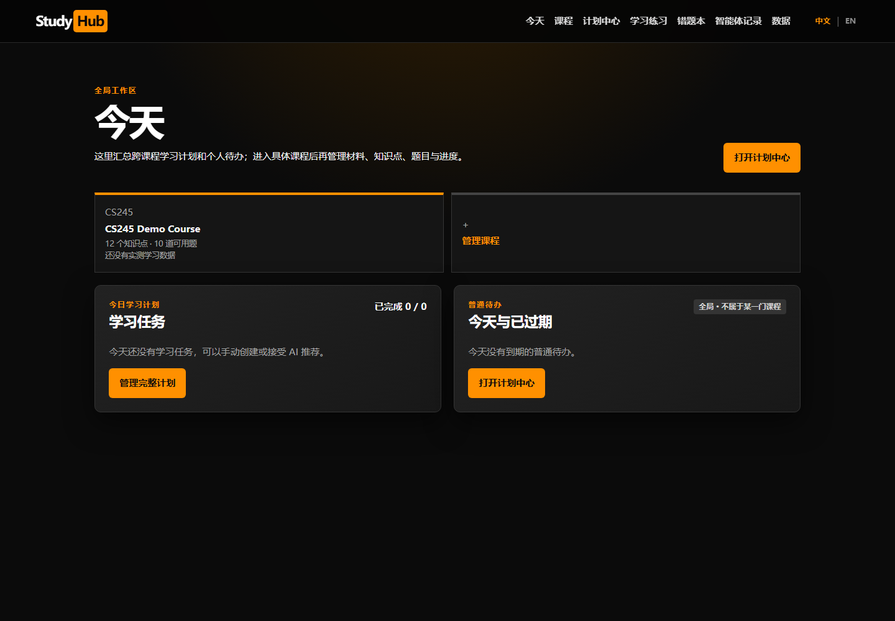
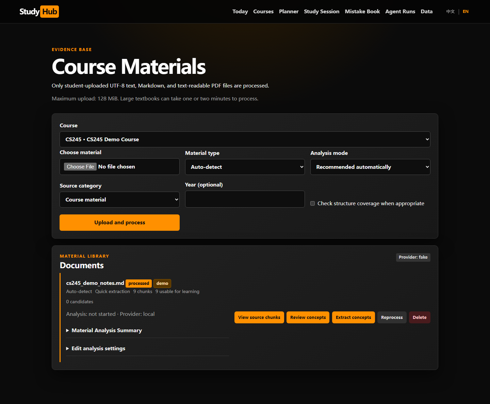
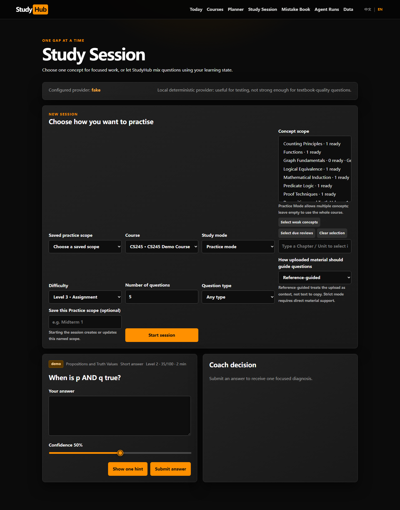
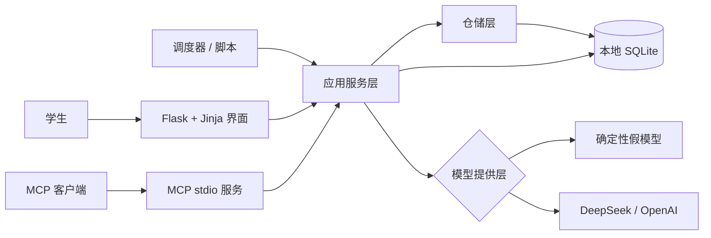

# StudyHub

**一个本地优先、基于资料证据的自适应学习工作区。**

[English](README.md) · [架构说明](docs/architecture.zh-CN.md) · [安全说明](SECURITY.md) · [参与贡献](CONTRIBUTING.md)

StudyHub 把课程资料转化为一个可追踪的学习闭环：

`课程资料 → 概念 → 审核后的题目 → 作答 → 诊断 → 掌握度 → 下一次复习`

它面向希望保留课程上下文、又不想把私人笔记直接变成通用云端聊天记录的学生。每门课程分别保存资料、概念、题目、错题、计划和进度。应用无需 API 密钥即可运行；只有在用户针对该课程明确授权后，才会调用外部 AI 服务。



> 当前状态：适合作品集展示的 Alpha 版本。核心学习流程已经实现并经过测试；登录、OCR 与生产环境部署不属于目前的单用户范围。

## 这个项目的工程亮点

- **完整学习闭环：** 作答后会更新掌握度、错误历史、连续表现与复习需求，而不只是返回一段聊天回答。
- **基于证据的 AI：** 概念与讲解保留到原始资料块的引用；没有可靠证据时会明确说明，不伪造出处。
- **人工审核关卡：** AI 生成的题目需要经过审核生命周期，才会进入常规练习。
- **本地优先隐私：** SQLite、上传文件、备份和本地生成的 Flask 密钥均保留在本机并排除在 Git 之外。
- **可替换的模型提供层：** 确定性的假模型支持离线演示和可重复测试；DeepSeek 与 OpenAI 均为可选项。
- **防御性设计：** 包含 CSRF 防护、幂等提交、模型输出校验、安全降级、备份验证与按课程授权外部 AI。
- **自动化质量门禁：** CI 会运行 Ruff、国际化检查、Alembic 升级、覆盖率门槛、依赖安全审计与真实 Chromium 冒烟测试。

## 产品预览

| 资料与概念审核 | 自适应学习会话 |
|---|---|
|  |  |

界面语言、课程资料语言和讲解语言可以分别设置。目前界面支持英语与简体中文。

## 架构概览



Flask 路由、MCP 工具、定时任务和维护脚本复用同一套服务与仓储层。学习闭环、安全边界和架构取舍请参阅[中文架构文档](docs/architecture.zh-CN.md)。

## 快速启动

要求：Python 3.11 或更高版本。

### Windows 一键启动

首次克隆后，双击 `start_studyhub.bat`。脚本会创建 `.venv`、安装依赖、升级数据库、写入合成演示数据，并打开 <http://127.0.0.1:5000>。

如果移动了项目目录，启动脚本会检测到虚拟环境仍属于旧位置。删除 `.venv` 后重新运行脚本即可；`instance/` 中的本地 StudyHub 数据不会受到影响。

### 手动安装

```powershell
python -m venv .venv
.\.venv\Scripts\Activate.ps1
python -m pip install -r requirements.txt
alembic upgrade head
python scripts\seed_demo.py
python -m flask --app app run --host 127.0.0.1
```

在 macOS/Linux 上，请使用 `source .venv/bin/activate` 激活环境，并将脚本路径改为正斜杠。使用 `Ctrl+C` 停止服务。

演示数据为合成的 CS245 风格内容，并非官方课程材料；默认使用确定性的 `FakeProvider`，因此无需 API 密钥。

## 可选 AI 服务

将 `.env.example` 复制为 `.env`。该文件已被 Git 忽略。

DeepSeek：

```dotenv
STUDYHUB_LLM_PROVIDER=deepseek
DEEPSEEK_API_KEY=your_key
DEEPSEEK_MODEL=deepseek-chat
```

OpenAI：

```dotenv
STUDYHUB_LLM_PROVIDER=real
OPENAI_API_KEY=your_key
OPENAI_MODEL=gpt-4.1-mini
```

涉及课程内容的外部调用，只有在对应课程明确启用后才会发生；否则 StudyHub 会回退到本地确定性提供层。

重要配置：

| 环境变量 | 默认值 | 用途 |
|---|---|---|
| `STUDYHUB_DATABASE_URL` | `sqlite:///instance/studyhub.db` | 本地数据库地址 |
| `STUDYHUB_LLM_PROVIDER` | `fake` | `fake`、`deepseek` 或 `real` |
| `STUDYHUB_MAX_UPLOAD_MB` | `128` | 上传大小上限 |
| `STUDYHUB_ENABLE_SCHEDULER` | `1` | 是否启用每日复习调度器 |
| `STUDYHUB_DEBUG` | `0` | 是否主动开启本地调试模式 |
| `STUDYHUB_SECRET_KEY` | 本地生成 | 可选的 Flask 会话密钥 |

支持可读取文本的 PDF、Markdown 和纯文本文件。只有扫描图像的 PDF 需要外部 OCR。

## 开发与验证

```powershell
python -m pip install -r requirements-dev.txt
ruff check .
python scripts\check_i18n.py
alembic upgrade head
pytest -m "not e2e" --cov --cov-report=term-missing
python -m playwright install chromium
pytest -m e2e
python -m pip_audit -r requirements.txt
```

GitHub Actions 会运行 Python 3.11 与 3.12 的质量检查，以及独立的 Chromium 端到端任务。测试覆盖服务行为、多课程隔离、网页流程、MCP 工具、备份、调度器、模型降级、CSRF 与浏览器导航。

## MCP 集成

使用 `python -m mcp_server` 启动独立 stdio 服务。配置示例（请把 `<repo>` 替换为克隆目录的绝对路径）：

```json
{
  "mcpServers": {
    "studyhub": {
      "command": "<repo>/.venv/Scripts/python.exe",
      "args": ["-m", "mcp_server"],
      "env": {
        "STUDYHUB_DATABASE_URL": "sqlite:///<repo>/instance/studyhub.db",
        "STUDYHUB_LLM_PROVIDER": "fake"
      }
    }
  }
}
```

可用工具包括 `search_course_material`、`get_student_state`、`save_attempt` 和 `schedule_review`。所有响应使用稳定的成功/错误结构；存在多门课程时会报告歧义，而不会静默选择。

## 仓库结构

```text
app/                 Flask 工厂、模块化路由、Jinja 界面、国际化与安全
models/              SQLAlchemy 实体
schemas/             Pydantic 数据契约
repositories/        持久化与幂等操作
services/            学习闭环、内容、检索、计划、备份与模型提供层
mcp_server/           独立 MCP stdio 服务
migrations/           Alembic 历史与旧版 SQLite 兼容升级
scripts/              演示、修复、回填与复习任务
skills/study-coach/   教学策略与结构化行为契约
tests/                单元、集成、网页、MCP、安全与浏览器测试
docs/                 架构、设计说明、验收报告与截图
```

## 隐私与安全

- 不要提交 `.env`、`instance/`、上传文件、数据库备份或真实课程资料。
- 服务仅绑定 `127.0.0.1`；Flask 开发服务器不用于公网部署。
- 浏览器表单的修改请求必须包含 CSRF 令牌；会话 Cookie 使用 `HttpOnly` 与 `SameSite=Strict`。
- 如果没有设置 `STUDYHUB_SECRET_KEY`，系统会在被忽略的本地目录中持久化随机密钥。
- 恢复数据库前会验证 SQLite 结构，并先为当前数据库创建安全备份。
- Agent 运行日志只保存摘要化输入、结构化决策、耗时和错误，不保存隐藏思维链。

报告安全问题前请阅读 [SECURITY.md](SECURITY.md)。

## 当前边界

StudyHub 目前面向单个本地学生，采用 SQLite、同步生成与有限范围的词法检索，并要求文档含有可读取文本。当前没有登录、OCR、后台任务队列或生产级 WSGI 部署。掌握度与难度是透明的启发式指标，并非经过心理测量学验证的分数；资料分析也不会声称完整覆盖课程大纲。

## 参与贡献与许可证

欢迎提交 Issue 和 Pull Request；请先阅读 [CONTRIBUTING.md](CONTRIBUTING.md)。StudyHub 使用 [MIT License](LICENSE) 开源。
