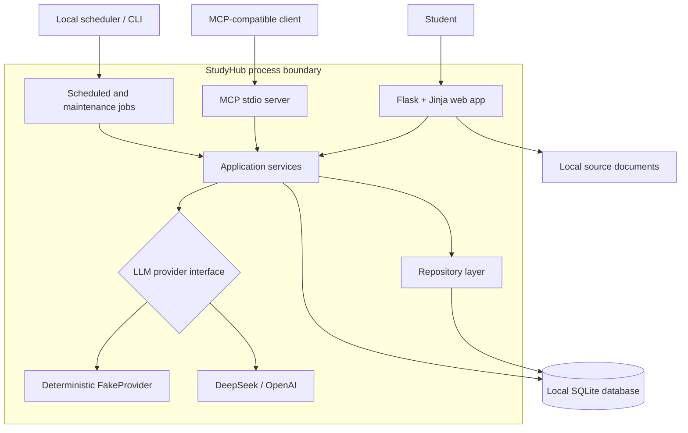
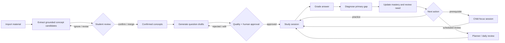
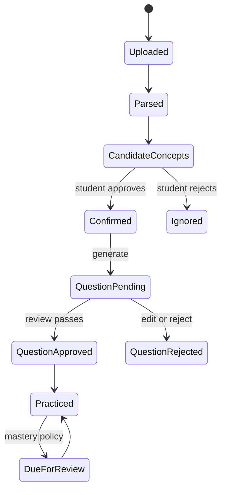
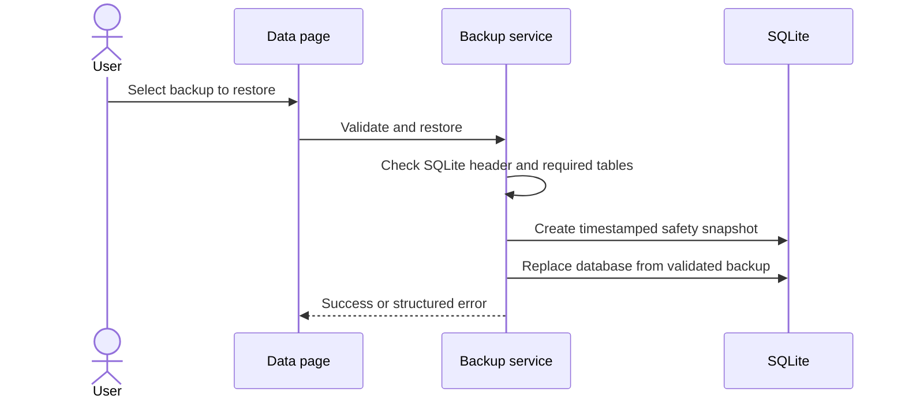
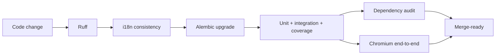

# StudyHub architecture

[中文架构说明](architecture.zh-CN.md) · [Back to README](../README.md)

StudyHub is a modular monolith optimized for a single local student. The web UI, MCP server, scheduler, and command-line jobs share the same application services and persistence model. This keeps the learning rules consistent while avoiding distributed-system overhead that the current scope does not need.

## System context

The external-provider edge is disabled by default. It is crossed only when a provider is configured and the selected course has explicitly allowed external AI use.

## Internal layers

| Layer | Responsibility | Main locations |
|---|---|---|
| Delivery | HTTP rendering/actions, MCP envelopes, CLI entry points | `app/routes/`, `mcp_server/`, `scripts/` |
| Application | Course, content, study, planning, mastery, backup, and scheduling workflows | `services/` |
| Contracts | Validated provider and domain payloads | `schemas/` |
| Persistence | SQLAlchemy entities and reusable learning operations | `models/`, `repositories/` |
| Infrastructure | SQLite, Alembic, provider adapters, Flask security | `migrations/`, `services/llm/`, `app/security.py` |

Routes are split by product area (`courses`, `materials`, `questions`, `study`, `planning`, and `operations`) but preserve one Flask blueprint and stable endpoint names.

## Learning loop

`AgentService.submit_attempt` implements the core `observe → diagnose → decide → act → update` cycle:

1. Load the question, confidence, prior failures, concept state, prerequisites, and permitted evidence.
2. Grade objective questions in code. Validate LLM output for short answers and derivations, retry once, then degrade safely.
3. Enforce bounded scores, a single primary gap, a known error taxonomy, a visible explanation, and an allowed next action.
4. Save the caller-provided `attempt_id`; repeated submission returns the existing decision.
5. Update mastery, streaks, confidence, recent error, last-practice time, and review need.
6. Record summarized inputs and structured decisions, never hidden chain-of-thought.

## Content and question lifecycle

Uploads are parsed page-by-page. Repeated page edges are removed and headings are detected when possible. Scanned image-only PDFs fail with an explicit OCR-not-supported message. Raw chunks remain inspectable but do not become concepts or citations unless they pass content-quality checks.

Generated questions retain provider, source policy, evidence chunks, expected answer, rubric, solution steps, difficulty dimensions, review notes, and moderation state. Normal sessions use active, approved, quality-passed questions only.

## Difficulty and selection

Question difficulty is an explainable weighted heuristic:

| Dimension | Weight |
|---|---:|
| Conceptual depth | 25% |
| Reasoning steps | 20% |
| Topic integration | 20% |
| Novelty | 15% |
| Calculation load | 10% |
| Prerequisite breadth | 10% |

Each dimension is scored 0–4 and mapped to a 0–100 score and Level 1–5. Selection combines weak, due, mistake, and retention signals while excluding inactive or unapproved questions and reducing immediate repetition. These are product heuristics, not psychometric claims.

## Persistence and migrations

SQLite is appropriate for a single local user and enables consistent online backups. Alembic owns the revision history through `0005_content_quality`. Startup also applies idempotent, additive compatibility checks so databases created by early local prototypes can be opened safely. Existing migrations intentionally avoid destructive downgrades because user learning history is more valuable than schema reversibility.

Key integrity rules include unique attempt IDs, one mastery record per attempt, one concept slug per course, document content de-duplication within a course, and one review task per student/concept/date.

Backup restore follows this sequence:

## Security and privacy boundary

- The development server binds to `127.0.0.1` and is not intended for direct internet exposure.
- Browser form mutations require a session-bound CSRF token; JSON APIs are excluded because they are not cookie-authenticated mutation endpoints in the current local model.
- Cookies are `HttpOnly` and `SameSite=Strict`.
- The Flask secret comes from `STUDYHUB_SECRET_KEY` or a random persisted file under ignored local storage.
- `.env`, databases, backups, uploads, and course documents are excluded from version control.
- External AI requires both global provider configuration and per-course consent.
- Evidence citations can only refer to imported material; a missing match produces an explicit no-evidence result.

This boundary fits the current single-user desktop workflow. Adding network access or multiple users would require authentication, authorization, production serving, rate limiting, and a broader threat model.

## Quality gates

GitHub Actions runs the quality job on Python 3.11 and 3.12 and a separate Playwright/Chromium job. The local suite also tests provider fallback, multi-course isolation, idempotency, backup consistency, scheduling, MCP error envelopes, and CSRF behavior.

## Deliberate trade-offs

- **Modular monolith over microservices:** simpler local setup and transactions; services can still be extracted later.
- **Server-rendered UI over a SPA:** smaller dependency surface and straightforward accessibility; fewer highly dynamic interactions.
- **SQLite over a remote database:** portable and private; not designed for concurrent multi-user writes.
- **Lexical retrieval over embeddings:** deterministic and offline; weaker semantic recall.
- **Synchronous generation over a job queue:** transparent control flow; long provider operations block the request.
- **Human-reviewed generation over full autonomy:** better learning safety and inspectability; more user effort.
