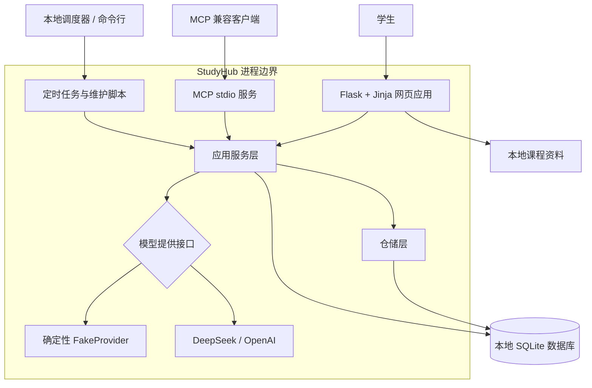
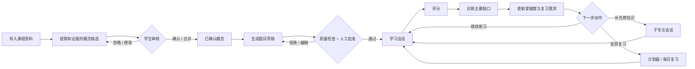
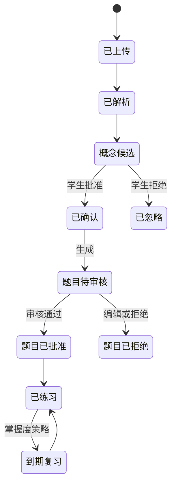
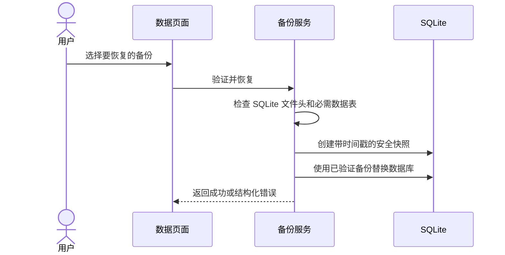
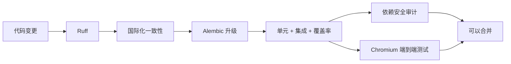

# StudyHub 架构说明

[English architecture](architecture.md) · [返回中文 README](../README.zh-CN.md)

StudyHub 是一个面向单个本地学生的模块化单体应用。网页界面、MCP 服务、调度器与命令行任务共享同一套应用服务和持久化模型，从而保持学习规则一致，同时避免当前规模并不需要的分布式系统复杂度。

## 系统上下文

默认不会跨越外部模型边界。只有在全局配置了外部提供商，并且当前课程明确同意使用外部 AI 时，才会发出相关请求。

## 内部分层

| 层级 | 职责 | 主要位置 |
|---|---|---|
| 交付层 | HTTP 页面与操作、MCP 响应结构、命令行入口 | `app/routes/`、`mcp_server/`、`scripts/` |
| 应用层 | 课程、内容、学习、计划、掌握度、备份与调度流程 | `services/` |
| 契约层 | 经过校验的模型与领域数据结构 | `schemas/` |
| 持久化层 | SQLAlchemy 实体与可复用学习数据操作 | `models/`、`repositories/` |
| 基础设施层 | SQLite、Alembic、模型适配器与 Flask 安全 | `migrations/`、`services/llm/`、`app/security.py` |

路由按照产品领域拆分为 `courses`、`materials`、`questions`、`study`、`planning` 和 `operations`，但继续使用一个 Flask Blueprint，并保持已有端点名称稳定。

## 学习闭环

`AgentService.submit_attempt` 实现核心的“观察 → 诊断 → 决策 → 行动 → 更新”流程：

1. 读取题目、信心值、历史失败、概念状态、先修关系和允许使用的资料证据。
2. 客观题由程序评分；简答与推导题的模型输出会经过校验，失败后重试一次，再安全降级。
3. 约束分数范围、单一主要缺口、已知错误分类、可见讲解和允许的下一步动作。
4. 保存调用方提供的 `attempt_id`；重复提交直接返回已有决策。
5. 更新掌握度、连续表现、平均信心、近期错误、最后练习时间和复习需求。
6. 记录摘要化输入与结构化决策，不保存隐藏思维链。

## 内容与题目生命周期

资料按页解析，并尽可能去除重复页眉页脚、识别标题。只有扫描图像的 PDF 会返回明确的“不支持 OCR”错误。原始文本块仍可查看，但只有通过内容质量检查后，才能用于概念和引用。

生成题目会保存提供商、来源策略、证据文本块、预期答案、评分标准、解题步骤、难度维度、审核记录和管理状态。常规会话只使用已启用、已批准且通过质量检查的题目。

## 难度与选题

题目难度使用可解释的加权启发式规则：

| 维度 | 权重 |
|---|---:|
| 概念深度 | 25% |
| 推理步骤 | 20% |
| 主题整合 | 20% |
| 新颖程度 | 15% |
| 计算量 | 10% |
| 先修知识广度 | 10% |

每个维度取值 0–4，再映射为 0–100 分和 1–5 级。选题综合薄弱项、到期项、错题与保持记忆等信号，排除未启用或未审核题目，并减少短时间内重复出现。这些是产品启发式规则，不代表心理测量学结论。

## 持久化与迁移

SQLite 适合单个本地用户，并支持一致的在线备份。Alembic 管理截至 `0005_content_quality` 的版本历史。启动时还会执行幂等、只增加不破坏的兼容检查，使早期本地原型创建的数据库仍可安全打开。已有迁移刻意不提供破坏性降级，因为用户学习历史比模式可逆性更重要。

关键完整性规则包括：全局唯一作答 ID、每次作答最多一条掌握度记录、每门课程唯一概念 slug、同一课程内资料内容去重，以及每个学生/概念/日期唯一复习任务。

备份恢复流程：

## 安全与隐私边界

- 开发服务器只绑定 `127.0.0.1`，不应直接暴露到公网。
- 浏览器表单的修改请求必须提供与会话绑定的 CSRF 令牌；当前本地模型中的 JSON API 不依赖 Cookie 鉴权，因此不适用该表单防护。
- Cookie 使用 `HttpOnly` 和 `SameSite=Strict`。
- Flask 密钥来自 `STUDYHUB_SECRET_KEY`，或保存在已忽略本地目录中的随机密钥文件。
- `.env`、数据库、备份、上传文件和课程资料均排除在版本控制之外。
- 外部 AI 同时要求全局提供商配置和按课程授权。
- 证据引用只能来自已导入资料；无法匹配时会明确返回“没有可靠证据”。

该边界适合当前的单用户桌面工作流。如果未来开放网络访问或多用户功能，还需要身份验证、授权、生产级服务、限流与更完整的威胁模型。

## 质量门禁

GitHub Actions 会在 Python 3.11 与 3.12 上运行质量任务，并运行独立的 Playwright/Chromium 任务。本地测试还覆盖模型降级、多课程隔离、幂等性、备份一致性、调度器、MCP 错误结构与 CSRF 行为。

## 有意做出的取舍

- **模块化单体而非微服务：** 本地安装和事务更简单，未来仍可拆分服务。
- **服务端渲染而非单页应用：** 依赖面更小、无障碍更直接，但高度动态交互较少。
- **SQLite 而非远程数据库：** 便携且隐私友好，但不面向多用户并发写入。
- **词法检索而非向量嵌入：** 确定性强且可离线，但语义召回能力较弱。
- **同步生成而非任务队列：** 控制流透明，但较慢的模型调用会阻塞当前请求。
- **人工审核而非完全自治：** 学习安全性与可检查性更强，但需要更多用户参与。
