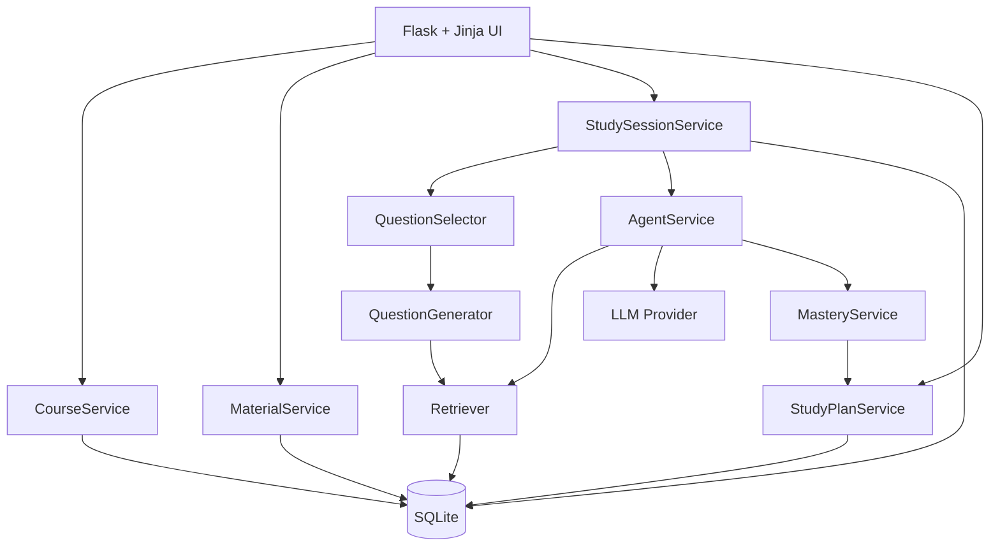

# StudyHub 需求分析与方案设计

版本：v0.1（讨论稿）
日期：2026-09-17
定位：本地个人学习工具、GitHub 求职展示项目

## 1. 文档目的

本文档定义 StudyHub 下一阶段的产品目标、业务规则、功能需求和技术方案，作为后续设计、实现与验收的共同基线。

当前版本不是面向公众上线的商业产品，因此优先解决个人学习体验、Agent 闭环完整性、代码可解释性和 GitHub 展示效果，不优先建设注册登录、多人协作、云端扩容和商业计费系统。

## 2. 产品愿景

StudyHub 是一个面向个人的自适应学习智能体。用户导入任意课程材料，系统帮助用户建立知识点结构、生成练习题、评价作答、解释答案、诊断错误、更新掌握度，并据此推荐下一题和学习计划。

核心闭环：

```text
课程材料
→ 知识点提取与确认
→ 选择课程和练习模式
→ 动态生成或选择题目
→ 学生作答
→ 评分与答案讲解
→ 错因诊断
→ 掌握度更新
→ 下一题、前置知识或学习计划
```

StudyHub 不是通用知识库，也不是 PDF 聊天机器人。课程材料的主要作用是约束知识范围、提供专业术语、支持出题和提供可核验 Evidence。

## 3. 用户与使用环境

### 3.1 核心用户

唯一核心用户是软件所有者本人：一名可能同时学习多门英文或中文课程的留学生。

### 3.2 使用环境

- Windows 本地运行；
- Python 3.11+ 与 Flask；
- SQLite 保存个人学习数据；
- DeepSeek 为主要真实 LLM Provider，FakeProvider 用于测试；
- 浏览器访问本地地址；
- 项目代码公开到 GitHub，但课程材料、API Key 和个人数据库不公开。

### 3.3 当前不考虑

- 注册、登录和多用户；
- 公开互联网部署；
- 付费订阅；
- 教师、班级和协作功能；
- 大规模并发；
- 移动 App；
- 自动抓取受版权保护的课程资料。

## 4. 产品原则

1. **学习优先**：材料检索是手段，练习、讲解和状态更新才是主流程。
2. **用户控制**：AI 可以推荐，但不能未经接受就替用户制定正式计划。
3. **来源透明**：Evidence 只能来自已导入材料；AI 通用知识必须明确标注。
4. **一次一个缺口**：每次评价只选择一个主要错误或知识缺口。
5. **每题都有讲解**：无论答案正确与否，都给出正确结论和简洁答案讲解。
6. **原文优先**：题目、Evidence 和专业术语尽量保留课程材料的语言。
7. **模型可替换**：业务规则不依赖某一家 LLM。
8. **规则可解释**：掌握度和选题策略应能用普通语言解释。
9. **本地与可恢复**：数据保存在本地，并能导出、备份和重建。
10. **展示价值**：架构、测试、错误处理和文档应能支持技术面试讲解。

## 5. 当前能力与主要缺口

| 能力 | 当前状态 | 目标状态 |
|---|---|---|
| 课程 | 数据表支持课程，但业务写死 CS245 | 用户创建、选择和管理多门课程 |
| 材料 | 支持 TXT、Markdown、文本型 PDF | 增加语言、章节、清理状态和重建索引 |
| 知识点 | 来自 demo seed | 从材料提取候选项，由用户确认 |
| 题目 | 主要是固定 demo 题 | 按课程、知识点、题型和难度动态生成 |
| Study Session | 单题提交 | 连续题目、目标进度、下一题与总结 |
| 练习模式 | 任务标签 | 精进、刷题、复习具有独立选题行为 |
| 评分 | LLM 结构化评价 | 按题型 Rubric 评分并建立回归评测集 |
| Evidence | 关键词检索 | FTS5/BM25、章节识别、中文与公式支持 |
| 掌握度 | 简单 EMA | 保持可解释，并纳入难度、提示和重复题 |
| 学习计划 | 已支持 CRUD 与 AI 推荐 | 与 Session 进度和自动完成联动 |
| 语言 | 中英文 UI 和讲解 | 课程语言、讲解语言和术语策略结构化 |
| 品牌 | 网页与内部标识均统一为 StudyHub | 发布前持续进行品牌名称检查 |

## 6. 信息架构

```text
StudyHub
├── Dashboard / 学习概览
│   ├── Today’s Plan / 今日学习计划
│   ├── AI Recommendations / AI 推荐
│   ├── Weak Concepts / 薄弱知识点
│   └── Recent Changes / 近期变化
├── Courses / 我的课程
│   └── Course Home / 课程主页
│       ├── Start Focus Practice / 精进模式
│       ├── Start Mixed Drill / 刷题模式
│       ├── Review / 复习模式
│       ├── Concepts / 知识点
│       ├── Materials / 课程材料
│       └── Progress / 课程进度
├── Study Session / 学习练习
├── Mistake Book / 错题本
├── Agent Runs / 智能体记录
└── Settings / 设置
    ├── Interface Language
    ├── Explanation Language
    ├── Terminology Policy
    ├── LLM Provider
    └── Backup / Export
```

## 7. 核心用户流程

### 7.1 创建课程与导入材料


### 7.2 精进模式

```text
选择课程
→ 选择知识点或输入学习目标
→ 选择题型、难度和题目数量
→ 诊断题
→ 根据作答调整下一题
→ 达到目标或建议复习前置知识
→ Session 总结
```

### 7.3 刷题模式

```text
选择课程或章节范围
→ 设置题数、题型和难度
→ 系统混合薄弱点、到期复习和覆盖题
→ 连续作答
→ 每题讲解
→ Session 总结与后续推荐
```

### 7.4 今日学习计划

```text
手动创建任务
或接受 AI 推荐
→ 点击开始
→ 创建 Study Session
→ 作答自动累计任务进度
→ 达到题数或时间目标
→ 自动完成任务
```

## 8. 功能需求

### FR-01 课程管理

- 用户可以创建、编辑和归档课程；
- 课程至少包含代码、名称、描述、主要语言和默认讲解语言；
- 导航栏或 Dashboard 可切换当前课程；
- 材料、知识点、题目、掌握度、错题和计划必须按课程隔离；
- demo 课程应清晰标记并可删除或重置。

### FR-02 材料导入

- 支持 UTF-8 TXT、Markdown 和文本型 PDF；
- 重复材料使用内容哈希保持幂等；
- 记录文件名、物理页码、章节、材料语言和处理状态；
- 清理重复页眉、页脚和异常空白；
- 用户可以删除材料并重建索引；
- 扫描型 PDF OCR 不作为当前必需功能。

### FR-03 知识点提取与审核

- AI 根据选定材料生成候选知识点；
- 每个候选知识点包含名称、描述、材料来源和可能的前置知识；
- 候选项必须经过用户接受、编辑、合并或拒绝后才进入正式知识图谱；
- 同一课程内知识点 slug 唯一；
- 专业术语保留材料原文，并可维护中英文别名。

### FR-04 题目生成

- 根据课程、知识点、材料片段、题型、难度和讲解语言生成题目；
- 支持选择题、简答题、计算题和证明题；
- 生成结果必须包含题目、标准答案、Rubric、难度、题型和来源片段；
- 题目保存后可复用，刷新页面不能重复生成；
- 生成失败时重试一次，仍失败则返回安全错误；
- 题目进入题库前应通过结构校验和 Evidence 支持检查。

### FR-05 精进模式

- 用户选择一个主要知识点；
- 系统优先选择或生成该知识点题目；
- 根据正确率、信心和错误类型调整难度；
- 发现前置缺失时允许插入前置知识题；
- Session 结束时汇总该知识点的表现与建议。

### FR-06 刷题模式

- 用户选择课程、章节或知识点范围；
- 用户设置题数、题型和难度；
- 默认选题建议为：50% 薄弱知识点、30% 到期复习、20% 覆盖与新内容；
- 避免同一 Session 和近期 Session 中重复题目；
- 第一版每题立即显示讲解，考试模式留作后续扩展。

### FR-07 复习模式

- 优先选择历史错题、到期知识点和低信心正确题；
- 不应直接重复展示旧答案；
- 可生成同知识点的变式题验证是否真正掌握；
- 复习成功后更新掌握度与下次建议时间。

### FR-08 Study Session

- Session 记录课程、模式、范围、目标、语言、开始与结束时间；
- 显示当前题号和整体进度；
- 每次只展示一道题；
- 提交后显示 Coach Decision、Primary Gap、Answer Explanation、Score 和 Mastery Change；
- Evidence 默认折叠；
- 提供下一题、结束 Session 和查看总结操作；
- Session 完成后自动更新关联 StudyTask。

### FR-09 作答评价

- 每次作答只选择一个主要错误类型；
- 无论正确与否，都提供答案讲解；
- 正确但低信心或解释不足时只小幅提高掌握度；
- 评价必须通过 Pydantic 校验；
- 模型输出失败时重试一次；
- 仍失败时不得伪造评分或讲解；
- 不记录完整 chain-of-thought。

### FR-10 Evidence 与 AI 通用知识

- Evidence 只能引用数据库中的材料片段；
- 模型返回的引用必须被检索结果替换或验证；
- 没有材料依据时显示“课程材料中未找到可靠依据”；
- 允许 AI 使用通用知识讲解，但必须明确标记为未经课程材料验证；
- 生成题目时使用的 Evidence 应与题目建立持久关联。

### FR-11 掌握度

- 范围始终为 0 到 1；
- 使用可解释规则，不宣称科学精确；
- 初始版本考虑正确性、得分、信心、难度、是否使用提示和近期重复；
- 保存每次变化记录，能够解释变化原因；
- AI 推荐不得直接修改掌握度。

### FR-12 今日学习计划

- 支持创建、编辑、完成、重新打开、删除和推迟；
- 任务可指定课程、知识点、模式、题数或分钟数、日期和备注；
- 手动任务与 AI 推荐明确区分；
- AI 推荐只有接受后才进入正式计划；
- 点击开始创建对应 Session；
- 达到题数或时间目标后自动完成；
- 显示今日完成数量和进度。

### FR-13 中英文与术语策略

- 页面提供 `中文 | EN` 切换；
- 界面语言与讲解语言可先绑定，后续允许分别设置；
- 题目和 Evidence 保持课程原文；
- 中文讲解英文课程时，专业术语保留英文；
- 中文课程使用中文术语；
- 课程和材料保存语言元数据，不完全依赖 Prompt 猜测。

### FR-14 错题本

- 可按课程、知识点、错误类型、日期和题型筛选；
- 显示原题、历史作答、答案讲解和来源；
- 支持“生成相似题”或“加入复习计划”；
- 旧记录保持提交时的语言和决策。

### FR-15 Agent Runs

- 保存操作、Provider、模型、工具调用、输入摘要、结构化结果、耗时和错误；
- 不保存 API Key；
- 不保存完整 chain-of-thought；
- 后续可记录 Token 用量和估算费用。

### FR-16 本地数据管理

- 支持备份 SQLite 数据库；
- 支持导出错题、掌握度和学习记录；
- 支持清除一门课程及其派生数据；
- 支持删除材料并重建索引；
- `.env`、数据库和用户课程材料不得提交到 GitHub。

## 9. 关键业务规则

1. 每个 Attempt 使用稳定且唯一的 `attempt_id`。
2. 重复提交同一 `attempt_id` 不新增 Attempt 或 MasteryRecord。
3. Question、Evaluation 和 AgentDecision 必须通过 Pydantic 校验。
4. 每次评价只能有一个主要 `error_type`。
5. 每次评价只能选择一个允许的 `next_action`。
6. 每次提交都显示答案讲解；Provider 失败除外。
7. Evidence 必须包含 document 和 page 或 section。
8. 没有 Evidence 时不得构造虚假引用。
9. AI 推荐不能直接进入用户任务，必须由用户接受。
10. 任务目标进度由关联 Session 和 Attempt 计算，不能只依赖按钮状态。
11. 课程材料、题目、Attempt、Mastery 和 Task 必须保留课程边界。
12. 删除操作优先使用软删除或明确的级联规则。

## 10. 建议数据模型

### 10.1 现有核心表

- `courses`
- `documents`
- `document_chunks`
- `concepts`
- `concept_edges`
- `questions`
- `attempts`
- `mastery_records`
- `review_tasks`
- `study_tasks`
- `agent_runs`

### 10.2 建议新增表

#### `concept_candidates`

保存 AI 从材料中提取、等待用户审核的知识点。

关键字段：

```text
course_id
name
description
language
source_chunk_ids
status: pending / accepted / rejected / merged
```

#### `question_sources`

持久保存题目与材料片段的多对多关系。

```text
question_id
document_chunk_id
relation: generated_from / supports_answer
```

#### `study_sessions`

```text
student_id
course_id
study_task_id
mode
target_type
target_value
scope_json
response_language
status
started_at
completed_at
```

#### `session_items`

```text
session_id
question_id
position
attempt_id
selection_reason
status
```

### 10.3 建议扩展字段

`courses`：

```text
primary_language
explanation_language
terminology_policy
status
```

`documents`：

```text
language
page_count
parser_version
```

`concepts`：

```text
canonical_name
name_en
name_zh
aliases_json
```

`questions`：

```text
question_type
language
generation_status
generator_model
content_hash
```

`attempts`：

```text
session_id
used_hint
response_language
duration_seconds
```

## 11. 服务设计



### 11.1 `CourseService`

- 创建、更新、归档和选择课程；
- 提供当前课程上下文；
- 管理课程语言和默认偏好。

### 11.2 `ConceptExtractionService`

- 根据材料片段生成知识点候选；
- 合并重复项；
- 生成前置关系建议；
- 不直接绕过用户审核写入正式知识图谱。

### 11.3 `QuestionGenerator`

- 生成结构化题目；
- 输入课程、知识点、题型、难度、语言和 Evidence；
- 输出 Question schema；
- 保存题目来源和模型信息。

### 11.4 `QuestionValidator`

- 验证题目是否明确；
- 验证标准答案是否被 Evidence 支持；
- 验证 Rubric 是否可执行；
- 对失败题目拒绝入库或要求重新生成。

### 11.5 `QuestionSelector`

- 根据模式、掌握度、近期重复和任务目标选择下一题；
- 返回结构化 `selection_reason`，便于 Agent Runs 展示。

### 11.6 `StudySessionService`

- 创建 Session；
- 获取下一题；
- 保存 Attempt；
- 更新 Session 和 StudyTask 进度；
- 生成 Session 总结。

### 11.7 `Retriever`

第一阶段采用 SQLite FTS5/BM25：

- 支持关键词权重；
- 支持中文字符 n-gram；
- 过滤页眉页脚；
- 按课程、材料和知识点过滤；
- 设置最低相关性和最大 Evidence 数量。

向量数据库不属于近期必需功能。

## 12. Question Schema 建议

```json
{
  "external_id": "generated-stable-id",
  "course_id": 1,
  "concept_id": 12,
  "question_type": "short_answer",
  "language": "en",
  "prompt": "State De Morgan's law for a conjunction.",
  "expected_answer": "NOT (p AND q) is equivalent to (NOT p) OR (NOT q).",
  "rubric": {
    "required_points": [
      "negates both operands",
      "changes conjunction to disjunction"
    ]
  },
  "difficulty": 0.4,
  "evidence_chunk_ids": [35]
}
```

题目 ID 可由课程、知识点、规范化题干和生成版本计算内容哈希，避免刷新或重试造成重复题。

## 13. 选题策略

### 13.1 精进模式

优先级：

1. 当前知识点未做过的适配难度题；
2. 最近错误类型对应的变式题；
3. 当前知识点的迁移题；
4. 明确诊断为前置缺失时的前置题。

### 13.2 刷题模式

建议初始权重：

```text
50% 薄弱知识点
30% 到期复习
20% 覆盖与新内容
```

权重必须可配置并记录选择原因，不应描述为科学最优。

### 13.3 防重复

- 同一 Session 不重复题目；
- 最近若干 Attempt 内降低重复权重；
- 复习时优先生成变式，而不是原题原样重放。

## 14. 掌握度方案

保留当前 EMA 思路，下一版加入简单修正系数：

```text
基础变化
× 难度系数
× 提示系数
× 重复题衰减系数
```

约束：

- 结果始终位于 `[0, 1]`；
- 每次变化保留 reason；
- 低信心正确仍只小幅增长；
- 使用提示后答对不能按完全独立完成处理；
- 同一道题短期重复答对不能快速刷高掌握度；
- 不在缺少新证据时自动降低掌握度，只标记为需要复习验证。

## 15. 中英文方案

语言分为三个维度：

1. `interface_language`：页面、按钮和状态；
2. `explanation_language`：AI 讲解；
3. `terminology_policy`：专业术语显示方式。

默认策略：

```text
interface_language = 用户选择
explanation_language = 跟随 interface_language
terminology_policy = source
```

例：英文材料、中文讲解：

> 这里使用 De Morgan's law，将 conjunction 的否定转换为 disjunction。

题目和 Evidence 不自动替换为翻译版本。后续可增加“查看翻译”，但原文必须始终可见。

## 16. 本地非功能需求

### 16.1 可运行性

- Python 3.11+；
- 新环境 10 分钟内完成安装与启动；
- 无 API Key 时 FakeProvider 可以完整运行测试和演示；
- 普通非 LLM 页面操作目标响应时间低于 2 秒。

### 16.2 可靠性

- 所有写操作具有唯一键或清晰幂等策略；
- LLM 输出必须先验证；
- Provider 网络错误不得破坏数据库事务；
- 数据库升级使用 Alembic 或可验证迁移脚本；
- 备份文件不覆盖原数据库。

### 16.3 本地安全

- API Key 只保存在 `.env` 或系统环境变量；
- `.env`、SQLite 数据库和上传材料必须被 Git 忽略；
- Agent Runs 不记录完整答案正文或私有推理；
- 发给外部 Provider 的材料范围应在界面和 README 中说明。

### 16.4 可测试性

- FakeProvider 流程必须确定性；
- 每项业务规则具有单元或集成测试；
- 关键页面至少有 Flask 客户端测试；
- 动态题目需要固定样例评测集；
- GitHub 发布前增加 CI 执行 `pytest -q`。

## 17. 分阶段实施方案

### 阶段 A：课程基础与数据库演进

- 引入 Alembic；
- 统一 StudyHub 品牌；
- 实现课程 CRUD 和当前课程选择；
- 去除后端 CS245 硬编码；
- 增加课程语言设置。

验收：创建第二门课程后，其材料、知识点、题目和进度与第一门课程隔离。

### 阶段 B：材料到知识点

- 文本清理和语言检测；
- FTS5/BM25；
- 概念候选提取；
- 用户审核页面；
- 前置关系建议。

验收：上传一份新课程材料后，用户可以审核并保存一组带来源的知识点。

### 阶段 C：题目生成与验证

- QuestionGenerator；
- QuestionValidator；
- 题型与难度；
- Question Sources；
- 预览、接受、编辑和重新生成。

验收：选择一个已确认知识点，可以生成、验证、保存并完成一道带 Evidence 的新题。

### 阶段 D：Study Session 与模式

- `study_sessions` 与 `session_items`；
- 精进模式；
- 刷题模式；
- 复习模式；
- 下一题和总结；
- 防重复。

验收：完成一个 5 题 Session 后可查看进度、总结、掌握度变化和选题原因。

### 阶段 E：计划联动与本地数据工具

- StudyTask 自动进度；
- AI 推荐与 ReviewTask 桥接；
- 导出错题、进度和学习记录；
- 数据库备份、课程删除和索引重建。

验收：从今日计划启动 5 题任务，完成第五题后任务自动完成。

### 阶段 F：GitHub 展示完善

- README 统一 StudyHub；
- 安全 demo 数据；
- 截图或短 GIF；
- CI；
- 架构图和设计决策记录；
- Professional / Playful 主题策略说明。

## 18. 总体验收场景

```text
1. 创建一门非 CS245 课程
2. 设置课程语言
3. 上传一份课程材料
4. AI 提取知识点候选
5. 用户编辑并确认知识点
6. 选择精进模式和一个知识点
7. AI 生成一组带 Evidence 的题目
8. 用户连续作答
9. 每题获得评分、答案讲解和折叠 Evidence
10. 系统更新错因和掌握度
11. Session 达到目标后自动完成今日任务
12. Dashboard 显示新的进度和 AI 推荐
13. 中文与英文界面均能完成上述流程
```

## 19. 待讨论与待确认事项

以下问题尚未最终决定，建议按顺序讨论：

1. 课程创建时哪些字段必须填写，课程代码是否允许为空；
2. 知识点提取应按整份材料还是用户选定页码进行；
3. 首批重点支持哪些题型；
4. 动态题目是先预生成题库，还是 Session 中按需生成；
5. AI 生成题目是否必须由用户预览确认；
6. 精进模式何时认为“本轮完成”；
7. 刷题模式的默认题数与选题比例；
8. 复习模式是否保留为第三种独立模式；
9. StudyTask 的分钟目标如何可靠统计；
10. 英文材料的中文讲解应保留多少英文术语；
11. 是否需要 Professional 与 Playful 两套主题；
12. 导出格式优先选择 Markdown、CSV 还是 JSON。

## 20. 当前建议的下一项决策

下一步先细化“课程创建与材料导入”流程，因为课程上下文是知识点提取、动态出题、Session、任务和语言策略的共同前提。

建议首先确认：

```text
创建课程时，用户需要填写哪些内容？
```

推荐的最小字段：

```text
课程名称（必填）
课程代码（可选）
课程主要语言（中文 / English / Mixed）
默认讲解语言（中文 / English）
专业术语策略（跟随材料 / 英文优先 / 中文优先）
```
